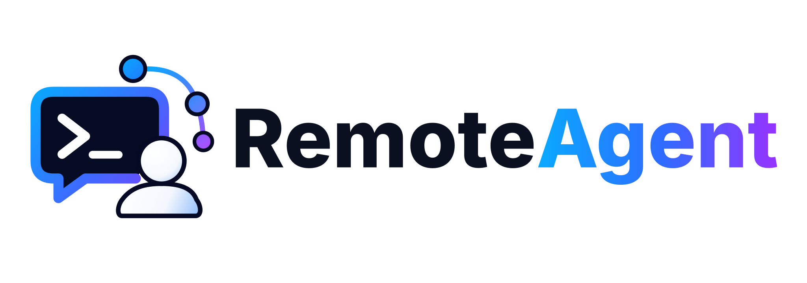
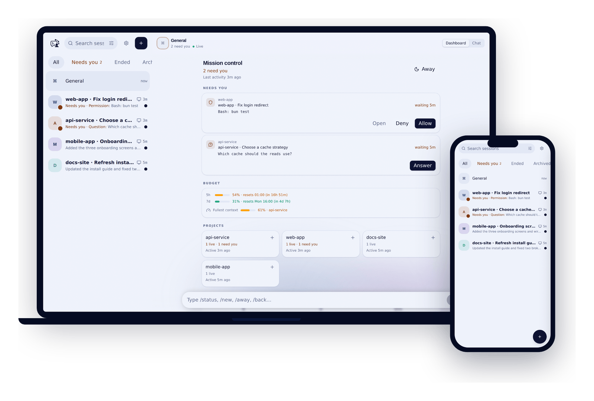
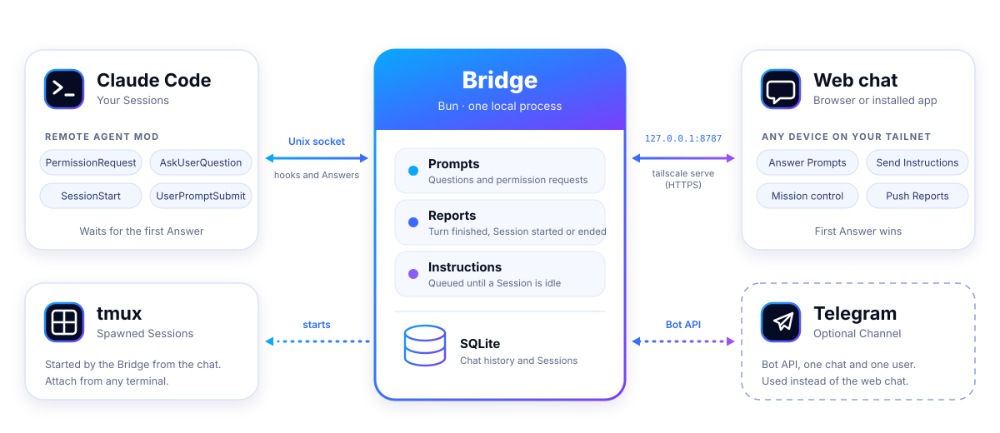

<p align="center">
  <picture>
    <source media="(prefers-color-scheme: dark)" srcset="docs/assets/remote-agent-logo-dark.svg">
    
  </picture>
</p>

# Remote Agent

Watch and steer your active [Claude Code](https://claude.com/claude-code) Sessions from a web chat (or Telegram). When a Session is blocked on a question or a permission request, you answer it from your phone and the Session carries on.

Remote Agent is for a single developer who runs Claude Code on their own machine and wants to stay in the loop away from the keyboard, without giving up control.

<p align="center">
  
</p>

## Contents

- [Mission](#mission)
- [Features](#features)
- [How it works](#how-it-works)
- [Platform support](#platform-support)
- [Prerequisites](#prerequisites)
- [Installation](#installation)
- [Configuration](#configuration)
- [Running](#running)
- [Using Remote Agent](#using-remote-agent)
- [Troubleshooting](#troubleshooting)
- [Development](#development)
- [Documentation](#documentation)
- [Security](#security)
- [Limitations](#limitations)
- [Contributing](#contributing)
- [License](#license)

## Mission

Claude Code Sessions often stop and wait for a human: a question, a permission to run a command, or a finished turn. Those stops are wasted time if you are in another room or on a train.

Remote Agent makes those stops cheap to handle from anywhere, while keeping you in control. It never approves anything on your behalf. Every Answer comes from you, and the first Answer wins, whether it was given in the terminal or remotely.

## Features

Remote Agent is built around one rule: a Session should never sit blocked because you stepped away from the keyboard.

### Never leave a Session blocked

- **Answer from anywhere.** Permission requests and questions reach your phone as buttons: allow or deny, pick an option, or type an answer. The first Answer wins, whether it comes from the terminal or your phone, and the Session carries on. Nothing is ever approved without you.
- **Needs you comes first.** Sessions waiting on you rise to the top of your list, and tapping a push notification opens the Session at its Prompt.
- **Notifications that respect your attention.** Prompts always push. Reports (turn finished, Session ended) push while Away mode is on, and nothing pushes while one of your clients is visible and focused. Web Push works on the installed app, including iPhone and iPad.

### Drive your Sessions from the chat

- **Start in one tap.** `/new`, or a project button on the dashboard, starts Claude Code in a detached tmux session inside a trusted folder. Attach to it from a terminal whenever you like.
- **Choose the model.** Start a Session on `opus`, `sonnet`, `haiku`, `opusplan`, or a full model id.
- **Pick up where you left off.** Resume an ended Session in place, in the same Chat and on the model it last used (or another one), or start a new Session forked from an earlier transcript.
- **Queue instructions.** Text you send to a busy Session waits and is delivered when it is idle.
- **Show, don't describe.** Attach screenshots and PDFs from a shared library (type `@`). The Session receives each file's path and reads it.

### See what your agents are doing

- **Mission control.** General opens as a dashboard: what needs you, with Allow and Deny right on the card; what is working now and the tool it is running; your remaining budget; your projects; and today's activity.
- **Usage at a glance.** Context usage per Session and your account limits are one tap away in the chat header.
- **Edits as diffs.** Edit tool calls show as a diff, with the changed characters highlighted.
- **Find anything fast.** Search Sessions by title, project, folder, last message, and draft. Pin up to five Sessions, and rename any Session from its header.

### Yours to run

- **Private by design.** The Bridge listens on loopback only. You reach it through Tailscale, and it accepts only your Tailscale login.
- **Set up in one command.** `./install.sh` on Linux and macOS (or Windows through WSL2), and `./remote-agent.sh` to start, stop and check the Bridge without systemd.
- **One chat on every device.** The web UI is an installable app with an offline shell, and unsent drafts follow you to your other devices.
- **Telegram if you prefer it.** Telegram is available as an optional Channel, switched on with one setting.

## How it works

<p align="center">
  <picture>
    <source media="(prefers-color-scheme: dark)" srcset="docs/assets/how-it-works-dark.svg">
    
  </picture>
</p>

- The **mod** is a Claude Code plugin. Its hooks send Prompts and Reports to the Bridge and wait for Answers.
- The **Bridge** holds pending Prompts, serves the web chat, and records history in SQLite.
- **Spawned Sessions** run inside tmux, started by the Bridge. Sessions you start yourself in a terminal are also supported, but they cannot be ended from chat.

The vocabulary used throughout (Session, Prompt, Answer, Report, Instruction, Trusted folder) is defined in [`CONTEXT.md`](CONTEXT.md).

## Platform support

| Platform        | Status    | Notes |
| :-------------- | :-------- | :---- |
| Linux (systemd) | Supported | The primary target, with systemd user services and tmux. |
| macOS           | Partial   | The Bridge and mod work. Sessions started from chat run in plain tmux, since macOS has no `systemd-run`. That path has not been tested on macOS yet. |
| Windows         | Via WSL2  | Run everything inside WSL2 with an Ubuntu distribution. Native Windows is not supported. |

## Prerequisites

| Dependency | Required | Used for | Install |
| :--------- | :------- | :------- | :------ |
| [Bun](https://bun.sh) 1.2 or newer | Yes | Runs the Bridge and the mod's hooks | `curl -fsSL https://bun.sh/install \| bash` |
| [Claude Code](https://claude.com/claude-code) | Yes | The Sessions you steer (tested with v2.1.290) | See Claude Code's install guide |
| tmux | Only to start Sessions from chat | Detached sessions for `/new` | `sudo apt install tmux`, `sudo dnf install tmux`, `brew install tmux` |
| systemd (user services) | Only for the background service on Linux | Runs the Bridge at login. Sessions started from chat get their own systemd scope when `systemd-run` is available. | Included on most Linux distributions |
| [Tailscale](https://tailscale.com) | Yes, for the web Channel | Private HTTPS access to the Bridge from your devices | See Tailscale's install guide |
| Telegram bot | Only for the Telegram Channel | Alternative to the web chat | See [Telegram setup](#telegram-setup) |
| Git | Yes | Cloning the repository | Your package manager |

Node.js is not required. Bun installs the project's dependencies.

## Installation

Use the install script for your platform, or follow the manual steps.

### Quick install (Linux and macOS)

```bash
git clone https://github.com/thullabdev/remote-agent.git
cd remote-agent
./install.sh
```

The script:

- installs Bun and tmux if they are missing, then installs dependencies and builds the web UI;
- creates `~/.config/remote-agent/env` from the template, or keeps your existing one;
- sets `REMOTE_AGENT_WEB_STATIC` to the built UI;
- installs the background service (systemd on Linux, launch agent on macOS);
- installs the Claude Code mod.

It is safe to run again. Options:

- `--no-service` skips the background Bridge service.
- `--no-plugin` skips the Claude Code mod.

The Bridge starts only once the configuration is valid. Until then, the script tells you what to edit. On Linux without systemd, the script uses `./remote-agent.sh` instead (see [Running](#running)).

### Quick install (Windows)

Remote Agent runs on Windows through WSL2. If you have not already, install WSL with an Ubuntu distribution (`wsl --install -d Ubuntu` in an administrator PowerShell, then reboot). Install Claude Code inside WSL too.

From PowerShell in the repository folder:

```powershell
.\install.ps1
```

This runs `install.sh` inside WSL.

> [!NOTE]
> For best performance, clone the repository inside the WSL file system (for example `~/remote-agent`) rather than under `/mnt/c`.

### Manual installation

Use this if you prefer to run each step yourself.

```bash
git clone https://github.com/thullabdev/remote-agent.git
cd remote-agent
bun install --frozen-lockfile

mkdir -p ~/.config/remote-agent
cp .env.example ~/.config/remote-agent/env
chmod 600 ~/.config/remote-agent/env
# Edit the file: see Configuration below.
```

Then choose how to run the Bridge (see [Running](#running)), and install the mod (see [Installing the Claude Code mod](#installing-the-claude-code-mod)).

#### Installing the Claude Code mod

```bash
claude plugin marketplace add /absolute/path/to/remote-agent/mod
claude plugin install remote-agent@remote-agent-local --scope user
claude plugin list
```

Sessions that were already running need `/reload-plugins` once. The plugin's hooks run with `bun`, so `bun` must be on the `PATH` that Claude Code uses. Check with `which bun` in a fresh shell.

## Configuration

The Bridge reads its settings from the environment. The background service reads `~/.config/remote-agent/env`. When you run the Bridge in a terminal from the repository, Bun also reads a `.env` file in the working directory.

### Web Channel (default)

The web Channel serves a JSON API, a WebSocket, and optionally the web UI. It listens on `127.0.0.1` only.

1. Set the two required values in `~/.config/remote-agent/env`:

   ```bash
   REMOTE_AGENT_WEB_ALLOWED_LOGIN=you@example.com        # your Tailscale login
   REMOTE_AGENT_WEB_ORIGINS=https://box.tail1234.ts.net  # your MagicDNS https URL, exactly
   ```

2. Publish the port over HTTPS on your tailnet:

   ```bash
   tailscale serve --bg 8787
   tailscale serve status    # shows the URL to use for REMOTE_AGENT_WEB_ORIGINS
   ```

3. Open that URL on a device in your tailnet. Tailscale adds the `Tailscale-User-Login` header, which the Bridge checks against `REMOTE_AGENT_WEB_ALLOWED_LOGIN`.

> [!WARNING]
> `REMOTE_AGENT_WEB_ORIGINS` must hold the full URL with `https://`. A bare host such as `box.tail1234.ts.net` never matches the browser's `Origin`, and every write is refused.

#### Serving the web UI

`bun run build` writes the UI to `dist/web-channel`, and `REMOTE_AGENT_WEB_STATIC` points the Bridge at that folder. The installer sets both. If you install by hand, do the same:

```bash
bun run build
echo 'REMOTE_AGENT_WEB_STATIC="/absolute/path/to/remote-agent/dist/web-channel"' >> ~/.config/remote-agent/env
```

Without this variable, the Bridge serves only the API and the WebSocket. To use the web chat as an app, open the page in a browser and choose **Install** (or Share, then **Add to Home Screen** on iOS).

#### Push notifications

Set `REMOTE_AGENT_VAPID_SUBJECT` to a `mailto:` address of yours, because some push services reject the default. The VAPID key pair is created once in `vapid.json` next to the database.

On iPhone and iPad, Web Push works only for a page added to the Home Screen and opened from there, over HTTPS (which `tailscale serve` provides).

### Telegram Channel (optional)

Telegram is off by default. To use it, set `REMOTE_AGENT_CHANNELS=telegram` and fill in the three `TELEGRAM_*` variables. Listing both `web,telegram` does not enable Telegram: the Bridge runs the web Channel only and logs why.

<a id="telegram-setup"></a>

1. In @BotFather, send `/newbot` and copy the token.
2. Create a private group, open its settings, and enable **Topics**. This converts it to a supergroup.
3. Add the bot as an **admin** with **Manage Topics**. Admin bots receive every message, so privacy mode does not matter.
4. Turn off "Remain anonymous" for your own admin account. Anonymous posts arrive from the group, not from you, and the allowlist drops them.
5. Get the chat id and your user id:
   - Put `TELEGRAM_BOT_TOKEN` in `.env`.
   - With the Bridge stopped, send a message in the group, then run `bun run telegram:ids`.
   - Use the supergroup (its id starts with `-100`) and your own user id.
   - Manual alternative: run `curl "https://api.telegram.org/bot<TOKEN>/getUpdates"` and read `message.chat.id` and `message.from.id`.

### Upgrading from the Telegram-only Bridge

The default Channel is now `web`. An existing Telegram deployment whose env file has not changed will refuse to start with `Invalid configuration` and name the missing `REMOTE_AGENT_WEB_*` variable. Either add `REMOTE_AGENT_CHANNELS=telegram` to keep Telegram only, or add the web variables above.

### All settings

| Variable | Default | Meaning |
| :------- | :------ | :------ |
| `REMOTE_AGENT_CHANNELS` | `web` | Comma list of `web` and `telegram`. Both means web only (logged). |
| `REMOTE_AGENT_WEB_PORT` | `8787` | Loopback port of the web Channel. |
| `REMOTE_AGENT_WEB_ALLOWED_LOGIN` | required with web | The Tailscale login allowed in. |
| `REMOTE_AGENT_WEB_ORIGINS` | required with web | Comma list of allowed origins, for example `https://box.tail1234.ts.net`. |
| `REMOTE_AGENT_WEB_TOKEN` | none | Optional bearer token for access that does not go through `tailscale serve`. |
| `REMOTE_AGENT_WEB_STATIC` | none | Built UI directory to serve, with an `index.html` fallback. |
| `REMOTE_AGENT_VAPID_SUBJECT` | `mailto:remote-agent@localhost` | Contact in the Web Push keys: a `mailto:` or `https:` URL. |
| `TELEGRAM_BOT_TOKEN`, `TELEGRAM_CHAT_ID`, `TELEGRAM_ALLOWED_USER_ID` | required with Telegram | See [Telegram Channel](#telegram-channel-optional). |
| `REMOTE_AGENT_DB` | `~/.local/state/remote-agent/bridge.db` | SQLite database (chat log, Sessions, Prompts). |
| `REMOTE_AGENT_PROJECTS` | none | Comma-separated folders Sessions may start in; `~` is expanded. |
| `CLAUDE_CONFIG_PATH` | `~/.claude.json` | Claude Code config whose project keys are also trusted folders. |
| `REMOTE_AGENT_REMINDER_MINUTES` | `30` | Reminder for a Prompt nobody answers. |
| `REMOTE_AGENT_SOCKET` | derived | Unix socket for the Bridge. Leave unset: the mod always connects to the default socket path. |

The Bridge refuses to start with a message that names each invalid or missing variable.

## Running

Choose one of the options below. When the Bridge is running, open the Tailscale URL from a device on your tailnet.

### Background service on Linux (recommended)

The installer sets this up. To do it by hand:

```bash
mkdir -p ~/.config/systemd/user
sed "s|%h/Sites/remote-agent|$PWD|" deploy/remote-agent.service > ~/.config/systemd/user/remote-agent.service
systemctl --user daemon-reload
systemctl --user enable --now remote-agent
journalctl --user -u remote-agent -f
```

After changing the unit file, copy it again and run `systemctl --user daemon-reload && systemctl --user restart remote-agent`. To keep the service running after you log out, run `loginctl enable-linger $USER`.

### Background agent on macOS

The installer writes a launch agent to `~/Library/LaunchAgents/com.remote-agent.bridge.plist` and logs to `~/Library/Logs/remote-agent.log`. Start it with:

```bash
launchctl bootstrap gui/$(id -u) ~/Library/LaunchAgents/com.remote-agent.bridge.plist
```

### Without systemd (`remote-agent.sh`)

Use this on Linux when systemd user services are not available, or whenever you prefer not to install a service. It reads the same config file.

```bash
./remote-agent.sh start --bg    # start in the background, log in ~/.local/state/remote-agent/bridge.log
./remote-agent.sh status        # is it running? lists active sessions: busy, pending prompts, unread, attach commands
./remote-agent.sh status --all  # the same, including ended sessions
./remote-agent.sh restart       # stop, then start in the background (picks up code changes)
./remote-agent.sh stop          # stop the background Bridge
./remote-agent.sh logs          # follow the log (Ctrl+C to leave)
./remote-agent.sh start         # foreground instead; Ctrl+C stops it
```

The script does not restart the Bridge after a crash or reboot. If you need that, use it alongside a login-time launcher of your own.

Starting Sessions from chat (`/new`) works without systemd too. Those Sessions run in plain tmux, outside a systemd scope, and still outlive the Bridge.

### Foreground (any platform, useful for development)

```bash
bun run bridge        # Ctrl+C stops it and removes the socket
```

## Using Remote Agent

Each Session appears as its own Chat. You answer Prompts, send Instructions, and run commands from there.

- **Each Session gets its own Chat** (web) or Thread (Telegram), titled `<project> · <name>`. The name comes from Claude Code (for example `/rename`), from your own rename in the Chat header, or, for a Session started from chat, from its first task. Until then it reads "New session". The Chat is created on the Session's first message and kept after the Session ends.
- **General is your dashboard.** It opens as "Mission control": Sessions that need you (with Allow and Deny on the card), what is working now, your budget, your projects, today's activity and recent events. Use the Dashboard and Chat switch in its header to reach the command chat, where `/new`, `/status`, `/away` and `/back` live.
- **The Session list** opens on **All**: General, then every live Session. Sessions that need you (a permission or question is waiting) come first, then Sessions you pinned (up to five; press and hold a live Session, or use Pin to top in its details), then Sessions with an unsent draft (newest edit first), then working ones, then the rest by latest message. Tapping a Session that needs you opens it at the Prompt, and so does tapping its push notification. **Needs you** and **Working** appear as tabs only while they hold something. **Ended** and **Archived** are tabs of their own, and an ended Session leaves All. The sliders icon in the search box narrows the list to Sessions started on your **Computer** or **Spawned** from Remote Agent. Search matches a Session's title, project, folder, last message and draft, every word in any order. Press and hold an ended Session to select it and archive it.
- **Drafts follow you.** The unsent message in a Chat is saved, so you can start it on one device and finish it on another.
- **Questions** are answered with the option buttons, or with free text for "Other". Multi-select questions are answered with numbers, such as `1,3`.
- **Permission requests** show Allow and Deny. Replying `allow` or `yes` allows, and `deny` or `no` denies. Any other reply denies, with that text sent as feedback to the agent.
- **Any other text** in a Session's Chat is an Instruction. It is queued if the Session is busy and delivered when it is idle.
- **Attach files.** Use the attach button, or type `@` in the composer, to open the library picker. Search it, and tap a file to attach it or tap again to detach it, so you can choose several without reopening it. A message takes up to five files. **Manage** in the picker opens the Library dialog, where you can see every file and how many messages use it, add files, and delete them (after a confirmation). Attachments work in Session Chats only, not in General.
- **Pin messages.** Use the bookmark button on a message to pin it. Pinned messages are listed in the Chat details.
- **Commands** (in the General Chat or any Chat):

  | Command | Effect |
  | :------ | :----- |
  | `/new [path]` | Start a Session in a trusted folder. With no path, shows a picker. |
  | `/new --resume [path]` | List recent histories in a trusted folder. Picking one of your ended Sessions resumes it in place, in the same Chat; picking an older history starts a new Session forked from it. |
  | `/new --model <model> [path]` (or `-m`) | Start with a specific model: `opus`, `sonnet`, `haiku`, `opusplan`, or a full id. |
  | `/end` | End a spawned Session (sends `/exit`, then kills it after 5 seconds if needed). |
  | `/away` / `/back` | Turn Away mode (pushed Reports) on or off. |
  | `/status` | List Sessions and pending Prompts. |

- **Attaching to a spawned Session** from a terminal: `tmux attach -t ra-<first 8 chars of the session id>`. Detach with `Ctrl-b d`. The command is shown in the Chat and in `/status`.

> [!NOTE]
> `/new` only starts Sessions in trusted folders: the exact paths in `REMOTE_AGENT_PROJECTS`, or project keys in Claude Code's `~/.claude.json`. Subfolders are not included.

## Troubleshooting

| Symptom | Likely cause | Fix |
| :------ | :----------- | :-- |
| `Invalid configuration: ...` at startup | A required variable is missing or malformed. | Read the message, fix the named variable in `~/.config/remote-agent/env`, and restart. |
| Refuses to start after an upgrade, naming `REMOTE_AGENT_WEB_*` | The default Channel is now `web`. | Add `REMOTE_AGENT_CHANNELS=telegram` or set the web variables. See [Upgrading](#upgrading-from-the-telegram-only-bridge). |
| Every write from the browser is refused | The `Origin` does not match `REMOTE_AGENT_WEB_ORIGINS`. | Use the exact URL from `tailscale serve status`, including `https://`, with no trailing slash. |
| Requests are rejected even though the URL is right | The Tailscale login differs from `REMOTE_AGENT_WEB_ALLOWED_LOGIN`, or the request did not come through `tailscale serve`. | Check the login in Tailscale for the device you are on, and open the URL from `tailscale serve status`. |
| `/new` fails because `tmux` is not found | tmux is not installed. | Install tmux (see [Prerequisites](#prerequisites)). |
| A started Session does not come up | Claude Code is waiting at a login prompt or other first-run screen. | The Bridge posts the last screen and stops the Session after 30 seconds. Attach with tmux to finish the setup. |
| Hooks fail with `bun: command not found` | Claude Code does not have `bun` on its `PATH`. | Put Bun's directory on the `PATH` used by Claude Code, then restart Claude Code. Check with `which bun` in a fresh shell. |
| A running Session ignores the mod | The Session started before the mod was installed or updated. | Run `/reload-plugins` in that Session. |
| The Bridge does not hear a Session that was already running | The Session has not yet sent a Report, Prompt, or title. | Send a message or wait for its next Report. |
| A Session stops after you log out (Linux) | The user service stops at logout without lingering. | Run `loginctl enable-linger $USER`. Sessions still do not survive a reboot. |
| `systemctl --user` fails | systemd user services are not available (for example in a container or WSL1). | Use `./remote-agent.sh start --bg`. |
| `./remote-agent.sh start` says the Bridge is already running | A background Bridge is still running. | Use `./remote-agent.sh restart`, or `stop` first. |
| Telegram answered a question first, but the terminal dialog stays open | Known limitation. | Press **Esc** in the terminal. It does not interrupt Claude. |
| Telegram does not reply in the group | The bot is not an admin with Manage Topics, or "Remain anonymous" is still on for you. | Check the steps in [Telegram setup](#telegram-setup). |

If none of these help, check the Bridge log (`journalctl --user -u remote-agent -f` on Linux, `~/Library/Logs/remote-agent.log` on macOS). Then open an issue with the log lines (redacted) and your platform.

## Development

This section covers working on Remote Agent itself.

### Setup

```bash
git clone https://github.com/thullabdev/remote-agent.git
cd remote-agent
bun install --frozen-lockfile
```

### Common tasks

| Task | Command |
| :--- | :------ |
| Run the Bridge in the foreground | `bun run bridge` |
| Run the Bridge and reload on change | `bun --watch run src/bridge/main.ts` |
| Run the web UI with hot reload | `bun run dev` (serves on `127.0.0.1:5173`, proxies `/api` and `/ws` to the Bridge) |
| Build the web UI | `bun run build` (output in `dist/web-channel`) |
| Run the tests | `bun test` |
| Type-check | `bun run typecheck` |
| Find a Telegram chat or user id | `bun run telegram:ids` |

Bun loads `.env` from the working directory automatically. Copy `.env.example` to `.env` for development and keep it out of version control (it is git-ignored).

### Developing against a throwaway Bridge

Use separate state so you never touch your real data:

```bash
mkdir -p /tmp/ra-dev
REMOTE_AGENT_CHANNELS=web \
REMOTE_AGENT_WEB_ALLOWED_LOGIN=dev@example.com \
REMOTE_AGENT_WEB_ORIGINS=http://127.0.0.1:5173 \
REMOTE_AGENT_WEB_TOKEN=dev-token \
REMOTE_AGENT_DB=/tmp/ra-dev/bridge.db \
bun run bridge
```

In another terminal, run `bun run dev`. The dev server proxies `/api` and `/ws` to the Bridge and adds the identity the Bridge expects. Set `REMOTE_AGENT_WEB_DEV_LOGIN` (or `REMOTE_AGENT_WEB_DEV_TOKEN`) to choose which identity the proxy sends.

To send a fake permission request without Claude Code, use the Bridge's socket. It is at `$XDG_RUNTIME_DIR/remote-agent/bridge.sock` on Linux, or `~/.local/state/remote-agent/bridge.sock` when `XDG_RUNTIME_DIR` is unset (macOS):

```bash
SOCK="${XDG_RUNTIME_DIR:+$XDG_RUNTIME_DIR/remote-agent/bridge.sock}"
SOCK="${SOCK:-$HOME/.local/state/remote-agent/bridge.sock}"
curl --unix-socket "$SOCK" http://bridge/health
curl --unix-socket "$SOCK" -X POST http://bridge/prompts \
  -d '{"promptId":"p:dev1","session":{"sessionId":"dev-session","cwd":"/tmp/demo"},"body":{"kind":"permission","tool":"Bash","input":{"command":"ls"}}}'
```

To load the mod into one Claude Code Session without installing it:

```bash
claude --plugin-dir /absolute/path/to/remote-agent/mod/remote-agent
```

### Project layout

| Path | Contents |
| :--- | :------- |
| `src/bridge/` | The Bridge: configuration, HTTP and WebSocket server, Prompts, spawning and launching Sessions, Telegram notifier. |
| `src/channel/` | Channels: `web/` (API, WebSocket, push, transcripts) and `telegram/`. |
| `src/ui/` | The React web client (Vite, Tailwind, shadcn-style components). |
| `src/core/` | Small shared helpers (JSON, text). |
| `mod/remote-agent/` | The Claude Code plugin: hooks, the Bridge client, and the hook scripts in `bin/`. |
| `test/` | Tests, mirroring `src/` and `mod/`. Fakes for tmux and Channels live in `test/support/`. |
| `deploy/` | The systemd user unit. |
| `public/` | PWA manifest, service worker and icons. |
| `docs/` | Design specs, ADRs, the web Channel developer guide and agent instructions. |
| `references/` | Research notes on Claude Code hooks, channels and Telegram. |

### Making a change

- Read [`CONTEXT.md`](CONTEXT.md) first so names match the domain language.
- Add or update tests in `test/` next to the behaviour you change. Run `bun test` and `bun run typecheck` before you open a pull request.
- For web client work, follow the [web channel developer guide](docs/web-channel-developer-guide.md). It covers the API, the WebSocket protocol and push.
- For a significant design decision, add an ADR under `docs/adr/`.

## Documentation

| Document | Contents |
| :------- | :------- |
| [`CONTEXT.md`](CONTEXT.md) | Domain language (Session, Prompt, Answer, Report, Instruction, Channel). |
| [`docs/web-channel-developer-guide.md`](docs/web-channel-developer-guide.md) | API, WebSocket protocol, push, and extending the web Channel. |
| [`docs/adr/`](docs/adr/) | Architecture decision records. |
| [`docs/superpowers/specs/`](docs/superpowers/specs/) | Design specifications. |
| [`references/`](references/README.md) | Research notes on Claude Code hooks, channels, and Telegram. |

## Security

- The Bridge listens on `127.0.0.1` only. Remote access goes through `tailscale serve`, which requires your tailnet identity.
- The web Channel accepts only the Tailscale login in `REMOTE_AGENT_WEB_ALLOWED_LOGIN`, from an origin in `REMOTE_AGENT_WEB_ORIGINS`.
- An optional bearer token is available for access that bypasses `tailscale serve`. Keep it secret.
- The Bridge's Unix socket is user-only (mode `0600`).
- Telegram accepts one chat and one user. Everything else is ignored.
- Text is redacted and truncated before storage, but redaction is pattern-based and best effort.
- The mod runs with your permissions and never approves anything without an Answer from you.

> [!IMPORTANT]
> Report security problems privately to the maintainer rather than in a public issue.

## Limitations

- **Single user.** One Bridge serves one person.
- **Platforms.** Windows is supported only through WSL2. macOS support is not yet tested end to end, including starting Sessions from chat.
- **Headless sessions** (`claude -p`, the Agent SDK) are not bridged.
- **Uploads** are images and PDFs only, up to 10 MB each and five per message. Uploaded files stay in the library until you delete them.
- **Telegram is not end-to-end encrypted.** Bot chats are readable by Telegram.
- **Permission races.** A permission request can be answered in the terminal or remotely. Whichever Answer comes first wins. Telegram may keep showing buttons for a request that was answered in the terminal until the tool call finishes.
- **Question dialogs** stay open in the terminal when a question was answered remotely. Press **Esc** to clear them.
- **Bridge availability.** If the Bridge is unreachable for more than about six seconds while a question is waiting, that question can only be answered in the terminal. A Bridge that accepts connections but hangs blocks the waiting hook until it is restarted.
- **Prompts time out in the hook** after about 9.5 minutes. Claude Code's own dialog keeps waiting, but the remote buttons are removed.
- **Sessions started from chat** run with your default permission mode and only in trusted folders. A Session that is not up within 30 seconds is stopped.
- **Persistence.** Spawned Sessions survive a Bridge restart and, with lingering enabled, a logout, but not a reboot.
- **Sessions already running** when the Bridge starts get their Chat at their next Report, Prompt, or title, not immediately.
- **Secret redaction** is best effort.

## Contributing

Contributions are welcome. Before starting larger work, open an issue so the approach can be agreed.

- Issues and specs are tracked in GitHub Issues. Triage labels are `needs-triage`, `needs-info`, `ready-for-agent`, `ready-for-human`, and `wontfix`.
- Keep pull requests focused, include tests for behaviour changes, and make sure `bun test` and `bun run typecheck` pass.
- Use the domain terms from [`CONTEXT.md`](CONTEXT.md) in code, comments, and issues.

## License

Remote Agent is released under the [MIT License](LICENSE).
